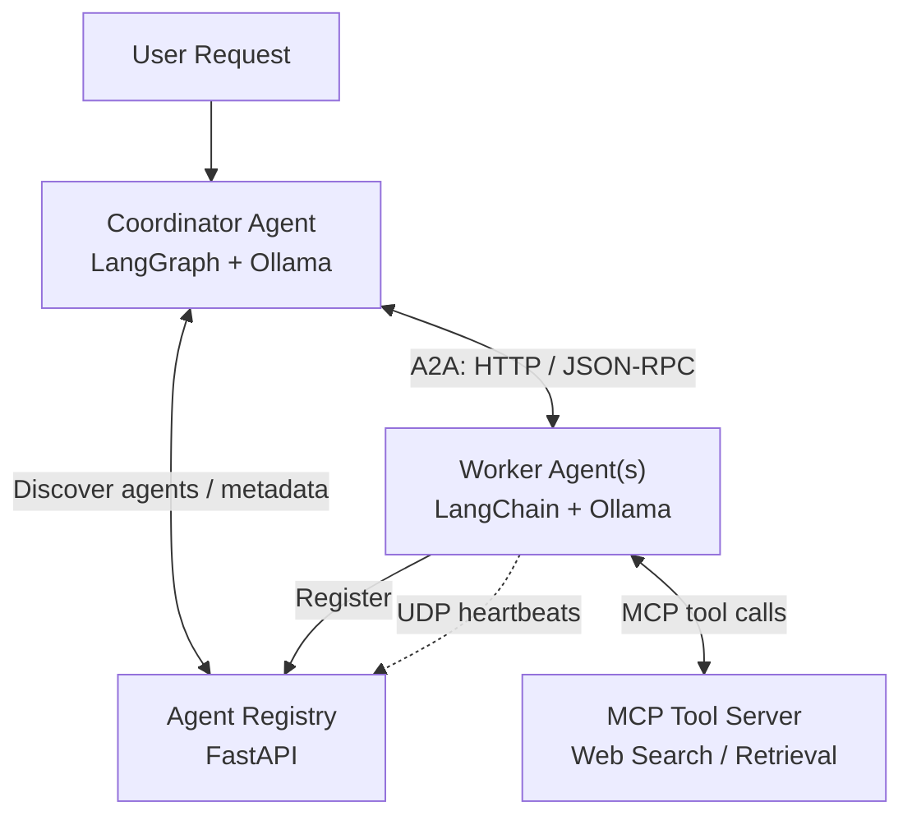

# Multi-Agent Architecture

**Building the coordination layer for modular, interoperable AI agents.**

**LangChain · LangGraph · Model Context Protocol (MCP) · Agent2Agent (A2A) · FastAPI · Ollama · Docker**

> **Status: Actively developed research/engineering prototype.** Core registration, discovery, heartbeat, orchestration, and A2A components are implemented. Docker-based deployment and several reliability/security capabilities are still in progress.

## Overview

What does it take to move beyond a single AI agent and build a *system of agents* that can discover one another, delegate work, and communicate through standard protocols?

**Multi-Agent Architecture** explores that question through a modular Python system with a central agent registry, a LangGraph-based coordinator, and specialized workers. It combines **A2A** for inter-agent communication with **MCP** for connecting agents to tools, while using locally served **Ollama** models for inference.

Rather than putting every capability inside one large agent, the project separates **discovery, orchestration, execution, and tool access**—the same boundaries that become important when designing more reliable and maintainable agentic applications.

## Key Engineering Highlights

- **Dynamic agent registration and discovery:** A FastAPI registry exposes agent metadata and discovery endpoints, so coordinators can find workers without holding Python object references to them.
- **Heartbeat-based liveness signals:** Workers send periodic UDP heartbeats to support runtime health tracking.
- **Graph-based orchestration:** A LangGraph coordinator plans a request, selects an available worker, delegates execution, and handles the result or an error.
- **Structured LLM decisions:** Ollama-backed planning uses Pydantic schemas for explicit worker selection and task instructions.
- **Protocol-based agent communication:** An A2A client/server layer exposes Agent Cards and exchanges text messages through HTTP/JSON-RPC.
- **Extensible tool access:** Specialized agents integrate with MCP-based tools, including a web-search/research workflow.
- **Engineering practices:** Async Python, typed data models, component tests with pytest, and GitHub Actions workflows.

## Architecture



### How a request flows

1. **Register:** Worker agents publish metadata and an A2A Agent Card URL to the registry.
2. **Discover:** The coordinator retrieves available worker metadata from the registry.
3. **Plan:** A LangGraph workflow uses structured LLM output to choose a worker and prepare its task.
4. **Delegate:** The coordinator contacts the worker through the A2A client, using the worker's Agent Card.
5. **Execute and respond:** The worker processes the request, optionally invokes MCP tools, and returns a text response through A2A.

**Current scope:** The coordinator delegates to **one worker per request**. Multi-worker parallel workflows, streaming responses, and durable A2A task handling are future extensions.

## Technology Stack

| Technology | Role in the system |
|---|---|
| **Python** | Async services, agent implementations, and runtime logic |
| **LangChain** | LLM-backed agents and tool-enabled task execution |
| **LangGraph** | Stateful coordinator workflow and conditional task routing |
| **MCP / FastMCP** | Standard interface for external tools, including web search |
| **Google A2A SDK** | Agent Cards and agent-to-agent message exchange |
| **FastAPI + Uvicorn** | Registry HTTP API and A2A service endpoints |
| **Ollama / ChatOllama** | Local inference with models such as `llama3.1:8b` |
| **Pydantic** | Typed agent metadata and structured task assignments |
| **HTTPX + UDP sockets** | Async HTTP messaging and heartbeat transport |
| **pytest + GitHub Actions** | Automated component testing and CI workflows |
| **Docker + Docker Compose** | Containerization/deployment work **in progress** |

## Core Components

**Agent Registry** — Manages registration, discovery, agent metadata, and heartbeat signals. The registry provides a lightweight discovery layer; it is not the transport used for task execution.

**BaseAgent** — Shared foundation for model configuration, registration, heartbeat management, and worker A2A server startup. Specialized agents extend this class.

**CoordinatorAgent** — Implements a LangGraph workflow: `plan → select → execute → finish`. It discovers worker metadata, generates a typed task assignment, and communicates with the selected worker over A2A.

**A2A Client / Server** — Handles remote agent requests and responses, including Agent Card exposure and JSON-RPC routes. The current implementation focuses on direct text-message exchange.

**MCP-enabled Worker** — Demonstrates how specialized agents can access external capabilities through MCP rather than embedding every tool directly into the coordination layer.

## Repository Layout

```text
Multi-Agent-Architecture/
├── .github/workflows/       # CI workflows
├── docker/                  # Docker-related work
├── src/
│   ├── agent/
│   │   ├── base.py          # Shared agent lifecycle
│   │   ├── coordinatorAgent.py
│   │   ├── A2A_client.py
│   │   ├── A2A_server.py
│   │   └── heartbeat.py
│   └── models/               # Typed agent / registry models
├── tests/                   # Component tests
├── compose.yaml             # Compose setup in progress
└── README.md
```

*This is a focused view of the main components, not an exhaustive file listing.*

## Local Development

The project currently uses a **manual, multi-service development setup**. A one-command Docker Compose workflow is not yet available.

**Prerequisites:** Python 3.12+, Ollama, and a local Ollama model (for example, `llama3.1:8b`).

```bash
git clone https://github.com/DanMint/Multi-Agent-Architecture.git
cd Multi-Agent-Architecture
python -m venv .venv
source .venv/bin/activate  # Windows PowerShell: .venv\Scripts\Activate.ps1

python -m pip install --upgrade pip
python -m pip install "langchain[mcp]>=1.4.0" langchain-ollama langgraph \
  "a2a-sdk[fastapi]" fastmcp fastapi uvicorn httpx pydantic \
  ddgs trafilatura pytest pytest-asyncio

ollama pull llama3.1:8b
```

Start Ollama and the relevant registry/agent/MCP services before attempting end-to-end tasks. Startup scripts, dependency pinning, and container orchestration are being refined as the project evolves.

### Tests

```bash
python -m pytest tests/ -v
```

Some tests may require running local services, mocked dependencies, or model access; a green end-to-end result is not implied by the presence of the test suite.

## Roadmap

- [x] Agent registration and discovery API
- [x] UDP heartbeat transport
- [x] LangGraph coordinator with structured worker selection
- [x] A2A client/server foundations and direct text messaging
- [x] MCP-based tool integration
- [x] pytest tests and GitHub Actions workflow scaffolding
- [ ] Complete Docker / Docker Compose startup
- [ ] Parallel and multi-step multi-agent task execution
- [ ] Persistent memory and durable task state
- [ ] Richer A2A task lifecycle, streaming, and cancellation
- [ ] Stronger observability, provenance, and replay
- [ ] Authentication, trust boundaries, and prompt-injection resilience
- [ ] Performance and reliability evaluation under failures

## Why I'm Building This

Agentic AI systems become more interesting—and harder to engineer—when agents operate as independent services. This project is a hands-on exploration of **interoperability, orchestration, service discovery, fault awareness, and secure agent communication**.

The longer-term direction is to connect the architecture with research into **trustworthy and observable agentic AI**, including failure analysis, provenance, and recovery.

**Built and maintained by [Daniel Mints](https://github.com/DanMint).** Feedback, technical discussions, and collaboration are welcome.
